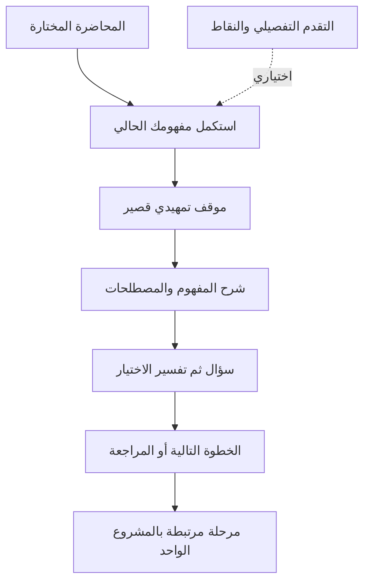

# مراجعة بورتال الأحد — شيراتون

تقرير استشاري لصاحب المشروع · ١ نوفمبر ٢٠٢٦ · بحث وتقييم فقط

**الحكم التنفيذي:** المنتج أقرب إلى كتاب تعلم تطبيقي متكامل بالفعل، وأفضل استثمار تالٍ هو تحسين ترتيب التعلم، واستمرارية المحاولة، وجودة الدليل على انتقال الفهم إلى قرار جديد. لا يوجد في نطاق الفحص عطل حرج مؤكد يستدعي تصنيف P0، ولا دليل يبرر إعادة بناء المنصة أو تغيير هويتها.

**حالة التسليم:** عند بوابة مراجعة المالك. لم يُعدّل كود أو محتوى أو نشر أو PR أو بيانات طلاب. التفاعل التجريبي اقتصر على متصفح المراجعة: علامة مراجعة تجريبية وإجابة تدريبية وتبديل لغة ومظهر؛ ليست سجلات طلاب رسمية. الملفات الناتجة منفصلة عن مستودع المنتج.

## منهج القراءة وحدود الثقة

أُجريت مراجعات مستقلة بواسطة ثلاثة مساعدين: التعليم والمنتج؛ التقنية والاختبارات؛ النشر والحوكمة والنقد. تولّى المراجع الأساسي تجربة المتصفح والتصميم ودمج التعارضات. الأدوار الثمانية أدناه زوايا تحليلية؛ لا ندّعي مشاركة خبراء بشريين أو إجراء مقابلات طلابية.

- **مؤكد بالمتصفح:** شوهد السلوك في هذه الجولة، مع لقطة أو ملاحظة تنفيذ.
- **مؤكد بالمصدر:** موضع قابل للفحص في النسخة المثبتة؛ لا يعني قياس الانتشار بين الطلاب.
- **استنتاج مهني:** تفسير أو توقع يحتاج تجربة بشرية.
- **مقترح:** تطوير لم يُنفذ ولم يحصل على قبول المالك.

المراجع البرمجية في التقرير تخص هذا [الالتزام المثبت](https://github.com/Dr-Torih/sunday-sheraton/tree/18ab7839c992f3a335bcfe6e8e264c0568dd4840). الملفات ذات البيانات المضغوطة قد تحتوي محاضرة كاملة في سطر واحد؛ يُذكر اسم البنية أو المفهوم لتسهيل الوصول. الملاحظات المتخصصة محفوظة في مجلد evidence، والتقرير الحالي يحسم التصنيف النهائي عند اختلافها.

## الجزء 01 — التشخيص التنفيذي

### ما ينجح ويستحق الحماية

1. تجربة واحدة تراكمية للمجموعة، بثلاث محاضرات فعلية، ومصطلحات سياقية، وخريطة قابلة للبحث، وشرح عربي وإنجليزي، ومظهرين.
2. تحكم الطالب في الانتقال بين المفاهيم، وانتقال الخريطة إلى عنوان المفهوم مع تركيز مرئي؛ أعيد اختباره على الهاتف.
3. فصل علامة مراجعة القراءة عن الإتقان موضح بالفعل؛ التقدم محلي ولا يدّعي اعتماد المحاضر.
4. مشروع واحد يتطور خلال ثماني مراحل، بمخرجات وأدلة وقوائم متابعة، بدل ثمانية تكليفات مستقلة.
5. اختبار تدريبي بسؤال واحد، وتفسير مرتبط بالمفهوم، وموازنة حروف الاختيارات عند العرض، وشهادة موضحة كتقييم ذاتي.
6. استرجاع كتابي قصير ومراجعة مركزة موجودان بالفعل؛ ليست هناك حاجة لإضافة طبقة ألعاب أو نظام تكيّف ثقيل.

### فرص التطوير الأعلى أثرًا

- نقل اختيارات الحالة الافتتاحية إلى ما بعد الشرح، مع الاحتفاظ بالموقف كتمهيد.
- التمييز بين نجاح التدريب على سؤال مألوف والقدرة على تبرير قرار في موقف جديد.
- حماية محاولة الاختبار من ضياع الإجابات عند إعادة التحميل، أو على الأقل توضيح ذلك ومنع الخروج غير المقصود.
- تعميم معاملة الوصول الجيدة للاختبار على بقية النوافذ.
- جعل أول شاشة تعرض خطوة تعلم واضحة بدل أن تستهلكها مقدمة وصور ومؤشرات متكررة.
- تسوية التوثيق والـPRs مع ما نُشر بالفعل، حتى لا يبدأ التطوير التالي من تصور قديم.

**القيمة المقترحة للمنتج:** يساعد الطالب على فهم مفهوم تسويقي، وتجريبه، ثم استخدام الدليل لتبرير قرار داخل خطة مشروع واحدة. احتياج المحاضر هو تقليل إعادة التوجيه والشرح المتكرر، لا بناء نظام إدارة طلاب جديد.

**ملاءمة المنتج:** توجد ملاءمة وظيفية واضحة لهذا الغرض في البنية؛ لا توجد بيانات استخدام أو مقابلات أو نتائج تعلم كافية لإثبات ملاءمة سوقية أو نجاح تعليمي مقاس.

## الجزء 02 — الحالة الحالية المثبتة

### الإصدار والنشر

- التزام main الحالي: `18ab7839c992f3a335bcfe6e8e264c0568dd4840`، بتاريخ ٢٨ أكتوبر ٢٠٢٦، دمج PR رقم 32.
- النشر: `github-pages`، معرّف `7394896243`، نجاح عند `2026-10-28T19:12:45Z`، أي ١٠:١٢:٤٥ مساءً بتوقيت القاهرة.
- ملف الصفحة الحية مطابق بايتًا لملف main المثبت: **872,942 bytes**؛ البصمة `SHA-256: b61a4bab52e21e23802afc5dae70bf2bb6d4d36975b0bce24d8f485a2c9be748`.
- التطابق يثبت ملف الصفحة الجذرية فقط؛ لم تُقارن بايتات جميع الصور والملفات الخارجية الحية.
- تسمية v3.1 في أجزاء التوثيق قديمة؛ رقم الالتزام هو تعريف الإصدار الأدق هنا.
- [تشغيل النشر الناجح](https://github.com/Dr-Torih/sunday-sheraton/actions/runs/40752140379) و[فحص سلامة المحتوى](https://github.com/Dr-Torih/sunday-sheraton/actions/runs/40752141245) لا يثبتان وحدهما قبول كل رحلة على أجهزة حقيقية.

| الخاصية | الموجود بالفعل | النضج والحكم |
|---|---|---|
| المحاضرة الأولى | ٢٥ مفهومًا، ست وحدات، ١٨ سؤالًا، ٦٥ مصطلحًا | مستقرة بنيويًا؛ محتواها السابق محمي |
| المحاضرة الثانية | ٣٠ مفهومًا، ست وحدات، ١٨ سؤالًا، ٨٣ مصطلحًا | مستقرة بنيويًا؛ تحتاج نفس اختبار الرحلات عند أي تغيير |
| المحاضرة الثالثة | ٢٥ مفهومًا، ست وحدات، ١٨ سؤالًا، ٣٠ مصطلحًا | منشورة؛ تحسين توافق الأهداف والقياس مقترح |
| المحاضرات التالية | خانات غير متاحة | مخطط لها؛ ليست محتوى منشورًا |
| الخريطة والتنقل | بحث ووحدات وانتقال داخل نفس التطبيق | جيد؛ الهاتف يطوي الخريطة |
| التقدم | مراجعة قراءة ونقاط ورتب ونتيجة محلية | مفيد؛ يفتقر إلى خطوة تالية بارزة واستمرارية المحاولة |
| التدريب والمراجعة | حالات وأسئلة قصيرة وتطبيقات واسترجاع ومراجعة بعد الاختبار | غني؛ يحتاج ضبط التسلسل والتمييز بين التمرين والانتقال |
| المشروع | ثماني مراحل وقائمة شخصية ودليل أصلي قابل للفتح | قوي؛ ليس مساحة فريق مشتركة ولا نظام تسليم |
| الشهادة | نتيجة نجاح محلية واسم عرض وصياغة تقييم ذاتي | موجودة؛ قبول الطباعة الأصلي لم يُعد في هذه الجولة |
| التحليلات | الوسم الأساسي وأحداث تعلم في المصدر | مؤشرات تفاعل؛ استقبال الخاصية الفعلي لم يُفحص |
| الصور | شريط تلقائي من ١٧ إطارًا | هوية اجتماعية مفيدة؛ قرار الحركة يحتاج مراجعة وصول |
| لوحة المحاضر | لا توجد لوحة درجات أو حسابات أو مزامنة | غياب مقصود ومناسب للنطاق الحالي |

### الـPRs المفتوحة: تسع مسودات، وليست تسع خصائص غير منشورة

| الطلب | علاقته بالنسخة الحالية | القرار الاستشاري |
|---|---|---|
| [12](https://github.com/Dr-Torih/sunday-sheraton/pull/12) | التنقل المكافئ نُشر لاحقًا عبر 13 | تسوية حالته؛ لا دمج تلقائي |
| [17](https://github.com/Dr-Torih/sunday-sheraton/pull/17) | أحداث المصطلحات واستبعاد متصفح المالك غير موجودين في main | مقترح فعلي منفصل؛ قياس وخصوصية قبل اعتماده |
| [19](https://github.com/Dr-Torih/sunday-sheraton/pull/19) | معالجة تركيز الاختبار مدمجة عبر 22 | الحفاظ على الموجود؛ تسوية المسودة |
| [20](https://github.com/Dr-Torih/sunday-sheraton/pull/20) | إصلاح تباين التنقل ضمن 22 | لا إعادة تطبيق عمياء |
| [21](https://github.com/Dr-Torih/sunday-sheraton/pull/21) | حالة تنقل نشطة واحدة ضمن 22 | الحفاظ عليها |
| [23](https://github.com/Dr-Torih/sunday-sheraton/pull/23) | اقتراح سابق لتنقل المشروع؛ البنية الحالية تطورت | إعادة مقارنة الفرق القابل للوصول قبل أي قرار |
| [24](https://github.com/Dr-Torih/sunday-sheraton/pull/24) | وثيقة تغطية المحاضرة الثالثة غير موجودة، رغم نشر المحاضرة | سد فجوة التتبع دون نشر المصادر الخاصة |
| [25](https://github.com/Dr-Torih/sunday-sheraton/pull/25) | المحاضرة الثالثة والمراحل نُشرت عبر 27 | ليست ميزة تنتظر الإطلاق |
| [26](https://github.com/Dr-Torih/sunday-sheraton/pull/26) | نسخة شهادة أقدم؛ الصيغة النهائية ضمن 27 | لا دمج منفصل؛ وصف 27 يحذر من ذلك |

في checkout المحلي المعروف لإصلاح الشهادة لا توجد تعديلات متتبعة غير محفوظة؛ توجد مخرجات فحص غير متتبعة وذاكرة Python. المراجع المحلية أقدم من النشر. هذا جرد محدود للمسار المعروف، وليس ادعاءً بعدم وجود أي مسودة أخرى على الجهاز.

### تعارضات التوثيق

الملفات الإلزامية قُرئت، ثم روجعت مقابل التنفيذ. أبرز التعارضات: README وAGENTS يصفان محاضرتين؛ ARCHITECTURE يصف أجزاء منشورة كمرشحات؛ NEXT_LECTURE ما زال يشرح إضافة المحاضرة الثالثة؛ أجزاء PROJECT_COMPANION تصف مربعات ربط قديمة محذوفة من الواجهة؛ بعض تعليمات الحركة القديمة تناقض قرار الحركة الأخير حتى عرض ١٠٢٤. كذلك توجد قاعدة الملف الواحد مع اتجاه مستقبلي لتعدد الصفحات؛ لا يلزم حسم معماري الآن، لكن لا يجوز استخدام النص القديم لتبرير إعادة بناء.

**المقترح:** صفحة حالة تشغيلية واحدة قصيرة، مرتبطة بالالتزام وخصائصه والاختبارات والقرارات السارية، مع وسم النصوص التاريخية بأنها مستبدلة. لا نحتاج وثيقة تصميم منافسة جديدة.

## الجزء 03 — رحلة التعلم ودور المحاضر

| الخطوة | المهمة الفعلية | صحة الرحلة في الفحص | فرصة التحسين |
|---|---|---|---|
| ١ | الدخول واختيار المحاضرة | متاح؛ اختيار ثلاث محاضرات ظاهر | محتوى أول شاشة يؤخر أول مفهوم؛ اختيار المحاضرة ضيق عند ٣٢٠ |
| ٢ | اكتشاف الخريطة وفتح مفهوم | ناجح؛ عنوان المفهوم أخذ التركيز والخريطة أغلقت | إبراز الاستكمال مباشرة للطالب العائد |
| ٣ | قراءة المثال والتفسير | شرح غني ومصطلحات سياقية | فصل الموقف التمهيدي عن السؤال القابل للإجابة |
| ٤ | تجربة سؤال ثم تغذية راجعة | موجود بالمصدر؛ ليس كل عنصر أُجيب عنه في المتصفح | تبرير القرار وربطه بالدليل، لا زيادة عدد الضغطات |
| ٥ | تسجيل المراجعة والعودة | موضع القراءة وعلامة المراجعة استمرا بعد التحميل | النقاط لا تغني عن توصية مراجعة محددة |
| ٦ | دخول الاختبار والتنقل | سؤال واحد، تركيز إغلاق، الوصول للسؤال الأخير؛ التسليم دون إجابات معطّل | إجابة تجريبية ضاعت بعد إعادة التحميل |
| ٧ | نتيجة النجاح والشهادة | آلية موجودة بالمصدر واختبارات مستودع سابقة | لم تُستكمل رحلة النجاح والطباعة في هذه الجولة؛ قبول منفصل |
| ٨ | الفريق يفتح المشروع والتسليم | المراحل الثماني ظاهرة؛ مرحلة التسليم تذكر الشروط المطلوبة | وضوح أن العلامات شخصية؛ توحيد ملخص التسليم |
| ٩ | العودة للمراجعة بعد أيام | القراءة محلية؛ محاكاة إعادة التحميل فقط | حفظ مفاهيم الأخطاء بعد اختبار مكتمل يحتاج تحقق وتنفيذ مقترح |

اختبار العودة هنا محاكاة بإعادة تحميل فورية، وليس متابعة طولية لعدة أيام. لا توجد مقابلات مع طلاب حقيقيين؛ احتمالات الترك أدناه فرضيات مدعومة بملاحظات واجهة، وليست معدلات انسحاب مقاسة.

### متطلبات المشروع: مطبقة، مع فجوة اتساق محدودة

تتضمن المرحلة الثامنة تقرير Word من ١٥ إلى ٢٠ صفحة، وخط متن لا يزيد على ١٢ نقطة، وعرضًا من ١٠ إلى ١٢ شريحة. تتضمن المرحلة الثانية ٣٠ استبيانًا حقيقيًا على الأقل لكل فريق. توجد أيضًا متطلبات سابقة بالدليل: عشر مقابلات وثلاثة مصادر ثانوية، وتوزيع درجات ومهلة تسليم. ليست إضافات أو موافقات جديدة من هذه المراجعة.

الدليل الأصلي يذكر حجم التقرير والعرض والبحث، لكنه لا يذكر حد الخط نفسه. هذه **فجوة اتساق بين السطوح**، لا غياب للشرط من البورتال. المصدر: `project-companion.js:617` داخل `decisionStages` و`project-guide.html:387–399`. المطلوب مزامنة معتمدة تحفظ النصوص الأكاديمية والملحقات المستثناة ومواعيد التسليم، أو ربط واضح بإضافة المحاضر.

المراحل الثماني مناسبة كخط سير، لكن لا ينبغي تحويل كل مرحلة إلى تسليم جديد. المقاييس التعليمية المفيدة هنا: هل القرار له دليل؟ هل الفرضية معلّمة؟ هل الفريق يستطيع تبرير البديل المرفوض؟ عدد العلامات الشخصية ليس بديلًا عنها.

### المحاضر داخل القاعة وبعدها

- الخريطة وروابط المفاهيم تسمحان باستدعاء موضوع بسرعة؛ الهاتف يضيف خطوة قائمة بينما سطح المكتب يعرض التنقل.
- العناوين والمصطلحات مفيدة على البروجيكتور، لكن شاشة البداية تعرض كثيرًا من عناصر التقدم قبل المحتوى. ملاءمة قاعة فعلية أو بروجيكتور لم تُختبر.
- أسلوب «مرتكز الطالب ثم نص المحاضر الخاص ثم مثال عالمي موثق» يمكن دعمه بفهرس خاص موجود خارج الموقع العام: رقم المفهوم، سؤال الشرح، مصدر المثال وتاريخه، وخطوة المشروع. لا نوصي بنشر نصوص المحاضر.
- استخدام مثال عالمي لا يمنح إذنًا بادعاء نتائج سببية أو أن المثال قُدم فعلًا في المحاضرة. التمييز الحالي بالمحاضرة الثالثة بين ما شُرح والتوسعات الأكاديمية يستحق الحماية.
- تقليل العبء الإداري يبدأ بتوحيد شروط التسليم والروابط والمرحلة الحالية؛ حسابات ومتابعة درجات جديدة ستضيف عبئًا لا يثبته الاحتياج الحالي.

## الجزء 04 — مداولة قاعة العمليات

| الدور | التوصية الأولية | الاعتراض | القرار بعد النقد |
|---|---|---|---|
| الاستراتيجية التعليمية | إضافة مزيد من الاختبارات التطبيقية | العدد لا يضمن انتقال التعلم | عينة مواقف غير مألوفة مع مبرر ودليل؛ لا توسيع المحرك |
| إدارة المنتج | مسار تعلم تكيّفي | مراجعة الأخطاء والاسترجاع موجودان | تحسين الاستمرار والخطوة التالية أولًا |
| تجربة الهاتف | إظهار المحتوى أسرع | الصور والهوية معتمدتان | طي اختياري أو مساحة افتتاحية أقصر، دون إزالة تلقائية |
| التصميم | إعادة تصميم لوحة التقدم | الهوية جيدة والمشكلة في الأولوية | نقل النقاط للتفاصيل وإبراز الاستكمال |
| المعماري والاختبار | تقسيم التطبيق أو إطار أحدث | لا يعالج جودة التعلم ويزيد كلفة الترحيل | إصلاح فحوص السكربت والتخزين والنوافذ فقط |
| محامي الشيطان | دمج الإصلاحات القديمة | بعضها منشور وبعض الكود غير قابل للوصول | مقارنة الدلتا مع main؛ لا دمج جماعي |
| الطالب المحبط | «أريد أن أعرف أين أبدأ وأكمل» | لا يوجد اختبار مستخدم فعلي يؤكد ذلك | تجربة قصيرة بمهمات واضحة قبل تعميم التغيير |
| المايسترو | تجميع الميزات المقترحة | ينتج منتجًا أثقل | حزم صغيرة: ثبات واستمرار، ثم ترتيب وقياس، ثم تجربة محدودة |

### خمس نقاط قد تدفع الطالب للتجاهل أو المغادرة

1. «فتحت الموقع ولسه مش شايف الفكرة نفسها»؛ أول شاشة الهاتف تمتلئ بالرأس والصور والمقدمة والتقدم.
2. «ليه أجاوب قبل ما أفهم؟»؛ الحالة التفاعلية تسبق جسم الشرح فعلًا.
3. «رجعت أكمل الاختبار ولقيت الإجابات اختفت»؛ أعيد إنتاجه.
4. «هل النقاط معناها إني فاهم؟ وإيه أعمل بعدها؟»؛ الرتب محسوبة من تفاعلات متعددة، والالتباس المحتمل يحتاج سؤال الطلاب.
5. «الفريق علم على المرحلة عنده، ليه مش ظاهرة عندي؟»؛ التخزين شخصي على المتصفح، والتحذير موجود لكنه قد يُنسى.

### مخاطر جوهرية غيّرت الخطة

- **تغيير الأسئلة قد يخرق تجميد المحتوى.** أي حزمة تقييم جديدة تحتاج اعتمادًا علميًا محددًا، لا تعديلًا تلقائيًا للأسئلة السابقة.
- **الدمج من فروع قديمة قد يعيد سلوكًا مستبدلًا.** تعتمد الحزمة على main الحالي ودلتا صغيرة، لا حالة PR وحدها.
- **المزامنة قد تُحوّل أداة مراجعة شخصية إلى نظام هوية وخصوصية ودعم.** أُجّلت الحسابات ومساحة الفريق.
- **تقليل الصور تلقائيًا يخالف قرارًا معتمدًا.** يقدم للمالك بديل إيقاف أو إخفاء اختياري مع بيان الوصول، دون تنفيذ.
- **ارتفاع النجاح أو الوقت قد يخفي تدريبًا على نفس السؤال.** يُقاس التبرير في سياق جديد، لا نسبة النجاح وحدها.

## الجزء 05 — التوصيات المرتبة ونموذج قياسها

تعني P1 أثرًا مرتفعًا على التعلم أو سهولة الاستخدام، وP2 تحسينًا مهمًا غير عاجل، وP3 استكشافًا مؤجلًا. لا يوجد P0 مثبت. درجة الثقة في وجود المشكلة منفصلة عن الثقة في أثر الحل؛ الأثر المتوقع تقدير مهني بلا نسب تحسين مختلقة.

| المعرف | الأولوية | المشكلة والدليل | الحل الأصغر والبديل | قياس النجاح |
|---|---|---|---|---|
| F01 | P1 | اختيارات حالة الوحدة قبل الشرح؛ `index.html:1799,1868–1875`؛ شاهد أول دخول | الاحتفاظ بالموقف وتمرير الاختيارات لما بعد المفهوم؛ بديل أقل تدخلًا: تنبؤ اختياري معلّم، لكنه لا يطابق تفضيلك الحالي | طالب جديد يشرح المفهوم ثم سبب اختياره دون مساعدة؛ ملاحظة الارتباك |
| F02 | P1 | تسعة من ١٨ سؤالًا بالمحاضرة الثالثة تتداخل بقوة مع التدريب؛ البيانات `1276`، الفحوص `1785`، التطبيقات `1290` | عينة انتقال بسياق وبيانات جديدة وتبرير قصير؛ بديل: موقف شفهي جديد بالقاعة دون تعديل السابق | جودة السبب والدليل والمفاضلة في موقف غير مألوف، ثم مراجعة مؤجلة |
| F03 | P1 | إجابة الاختبار ضاعت بالتحميل؛ الحالة في الذاكرة `1334,1502` | مسودة محلية لكل محاضرة بإصدار واضح؛ بديل فوري: تنبيه قبل الخروج وبيان أن المحاولة لا تُحفظ | استرجاع السؤال والإجابات بعد التحميل والتبديل دون تغيير نتيجة نجاح محفوظة |
| F04 | P1 | خروج التركيز خلف المصطلحات؛ لقطة 13 و`1685` | إعادة استخدام دورة نافذة الاختبار لبقية النوافذ؛ لا مكتبة جديدة | فتح وتنقل وإغلاق وإعادة تركيز بلوحة المفاتيح لكل نافذة؛ ثم قارئ شاشة |
| F05 | P1 | الصور مستمرة بلا إيقاف ظاهر؛ قرار مصدر `1131–1150` | خيار إخفاء/إيقاف يحافظ على التشغيل الافتراضي؛ احترام تقليل الحركة قرار يحتاج موافقتك؛ بديل مساحة قراءة ساكنة | إمكانية إيقاف الحركة وإعادة تشغيلها بكل وسيلة إدخال؛ اختبار تفضيل النظام |
| F06 | P1 | فحص main يختار آخر سكربت فأصبح يفحص المعرض؛ workflow `30–34` | فحص كل السكربتات التنفيذية والملف الخارجي؛ إضافة مساره للمشغّل | عينة صياغة معطوبة في أي سكربت تُرفض؛ JSON الأكاديمي مستثنى |
| F07 | P1 | تضارب التوثيق والحالة المنشورة، الجزء 02 | بيان حالة واحد وتاريخ إبطال النص القديم؛ تسوية المسودات بعد مراجعة | المراجع التالي يحدد المحاضرات والميزات والنشر بلا تعارض |
| F08 | P2 | بداية الهاتف مزدحمة؛ اللقطات 09 و10، واختيار المحاضرة مقصوص عند ٣٢٠ | استكمال ومرحلة حالية بارزان، نقاط داخل التفاصيل، اختيار أوسع؛ بديل إبقاء التصميم واختبار نسختين من ترتيب العناصر | إنجاز مهمة الوصول للمفهوم والمشروع دون مساعدة، مع قياس خطوات لا زيارات |
| F09 | P2 | حد الخط موجود بالمرحلة الثامنة وغائب بالدليل الأصلي | عقد تسليم واحد معتمد أو إضافة مرتبطة واضحة | نفس الشروط تُستخرج من كل مدخل، دون تكليف جديد |
| F10 | P2 | JSON صحيح بنوع خطأ قد يوقف التهيئة؛ `1328–1332` | تحقق أنواع واستعادة حقل واحد؛ بديل إرشاد استعادة محدود | بيانات مفقودة/تالفة/ممنوعة لا تعطل القراءة ولا تمحو السليم |
| F11 | P2 | النقاط والرتب لا تشترط دليل مشروع؛ `1790–1791` | جعلها تفصيلًا اختياريًا وتوضيح معنى الرتبة؛ بديل بيان تفسير مع الحفاظ على الشكل | الطالب يميز المراجعة عن الاختبار عن إثبات التطبيق |
| F12 | P2 | أهداف المحاضرة الثالثة تستخدم قالبًا عامًا؛ `1276` | خريطة خاصة لنتيجة قابلة للملاحظة ثم تعديل انتقائي معتمد؛ بديل الخريطة الخاصة فقط | كل هدف مهم مرتبط بتدريب ومخرج تقييم مناسب |
| F13 | P2 | حجم الصفحة والطلبات الخارجية؛ لا قياس ميداني | قياس هاتف وشبكة ممثلين أولًا؛ ثم تأجيل الصور غير المرئية إن ثبت الأثر | بيانات تحميل وتفاعل وطلب دليل المشروع، مع مقارنة نفس الجهاز والشبكة |
| F14 | P2 | فشل تحميل الدليل يطلب إعادة تحميل؛ companion `544–572` | إعادة محاولة داخل القسم؛ بديل إعادة فتح الدليل القائمة | فشل ثم عودة شبكة يستعيد الدليل دون فقد عمل آخر |
| F15 | P2 | صفحة تفسير منفصلة تستورد خطوطًا ثم تستخدم قديمة؛ `1977` | توحيد خطوط الهوية الحالية فقط | تطابق الخطوط المقروءة عربيًا وإنجليزيًا دون فقد موضع الاختبار |
| F16 | P3 | أحداث المصطلحات والاستبعاد مرشحة في 17 | سؤال قياس محدد ثم مراجعة خصوصية واختبار استقبال؛ بديل عدم إضافة أحداث | حدث فعلي فريد بلا أسماء/إجابات، وفصل زيارات المالك بعد التحقق |

### الأثر والكلفة والاعتماديات

ترتيب الأعمدة: أثر تعليمي، أثر تجربة، جهد، خطر تقني، عبء صيانة. القيم مرتفع/متوسط/منخفض تقديرات لا قياسات.

| المعرف | الأثر التعليمي | أثر التجربة | الجهد | الخطر | الصيانة | الثقة والاعتماديات |
|---|---|---|---|---|---|---| 
| F01 | مرتفع | مرتفع | متوسط | منخفض | منخفض | مرتفعة للترتيب؛ اعتماد تسلسل ومحتوى |
| F02 | مرتفع | متوسط | متوسط | منخفض | متوسط | مرتفعة للتداخل؛ علمي وثنائي اللغة |
| F03 | متوسط | مرتفع | متوسط | متوسط | متوسط | مرتفعة؛ نسخة أسئلة ومفاتيح تخزين |
| F04 | متوسط | مرتفع | متوسط | منخفض | منخفض | مرتفعة للمصطلحات؛ بقية النوافذ تحتاج إعادة إنتاج |
| F05 | متوسط | مرتفع | منخفض | منخفض | منخفض | مرتفعة للمصدر؛ مراجعة قرار الحركة |
| F06 | منخفض | متوسط | منخفض | منخفض | منخفض | مرتفعة؛ اعتماد حزمة تقنية |
| F07 | متوسط | متوسط | منخفض | منخفض | منخفض | مرتفعة؛ مراجعة قرارات النشر |
| F08 | متوسط | مرتفع | متوسط | منخفض | منخفض | مرتفعة للشاشة؛ فائدة الترتيب فرضية |
| F09 | متوسط | متوسط | منخفض | منخفض | منخفض | مرتفعة؛ موافقة مزامنة النص |
| F10 | منخفض | مرتفع | منخفض | متوسط | منخفض | مرتفعة للآلية؛ معدل الحدوث مجهول |
| F11 | متوسط | متوسط | منخفض | منخفض | منخفض | مرتفعة للمعادلة؛ الالتباس محتمل |
| F12 | متوسط | منخفض | متوسط | منخفض | منخفض | مرتفعة للقالب؛ اعتماد علمي |
| F13 | متوسط | متوسط | متوسط | منخفض | منخفض | متوسطة للأثر؛ جهاز وشبكة فعليان |
| F14 | منخفض | متوسط | منخفض | منخفض | منخفض | مرتفعة للمصدر؛ اختبار فشل شبكة |
| F15 | منخفض | متوسط | منخفض | منخفض | منخفض | مرتفعة للمصدر؛ فحص الخط المحسوب |
| F16 | منخفض | منخفض | متوسط | منخفض | متوسط | غياب مؤكد؛ استقبال وخصوصية غير متحققين |

### لماذا هذه الحلول؟ وما سلبياتها؟

- يدعم التوافق بين الهدف والتدريب والتقييم استخدام مهمة تطبيق وسبب، بدل اعتبار سؤال التعرف إثباتًا لقدرة تحليلية. [مركز التعليم بجامعة كارنيغي ميلون](https://www.cmu.edu/teaching/assessment/basics/alignment.html). هذا إرشاد أكاديمي، وليس دراسة عن طلاب هذا البورتال.
- الاسترجاع والتغذية الراجعة مفيدان؛ تكرار السؤال ليس خطأ بذاته. المشكلة في تفسير درجته كدليل انتقال مستقل. [دليل الباحثين للاسترجاع](https://pdf.retrievalpractice.org/RetrievalPracticeGuide.pdf). المقترح الجديد يزيد عبء المراجعة العلمية؛ البديل الشفهي أقل صيانة.
- تقليل العناصر المنافسة وإظهار المثال ثم التدريب اقتراح يستند إلى مبادئ الحمل المعرفي؛ مقدار التشتيت هنا لم يُقَس. [دليل مركز إحصاءات وتقييم التعليم](https://education.nsw.gov.au/about-us/education-data-and-research/cese/publications/practical-guides-for-educators/cognitive-load-theory-in-practice.html). طي عناصر كثيرة قد يضر اكتشافها؛ لذلك يحفظ خيار التوسيع.
- إعطاء الطالب اختيارًا وتقليل عوائق المشاركة يتوافق مع [إرشادات التصميم الشامل للتعلم](https://udlguidelines.cast.org/). لا يثبت امتثال المنتج كله.
- وجود حركة تلقائية مستمرة مع المحتوى وغياب تحكم ظاهر يثير معيار الإيقاف/الإخفاء. [شرح معيار الوصول لدى W3C](https://www.w3.org/WAI/WCAG22/Understanding/pause-stop-hide). هذا لا يبرر عكس قرارك تلقائيًا، ولا يُعد تدقيق امتثال شاملًا.
- حفظ المسودة مفيد لكنه يضيف مخاطر تغير ترتيب الأسئلة وجهاز مشترك وبيانات تالفة. يعتمد الحل على رقم نسخة وحفظ المؤشر الأصلي للاختيار، لا حرف العرض، ومسح اختياري للمحاولة وحدها.
- توحيد النوافذ قد يسبب تراكب تركيز جديد إن كانت هناك نافذتان؛ القبول يشمل كل مسار فتح وإغلاق واستعادة، لا اختبار زر واحد.

### المقارنة المرجعية: أنماط محدودة لا تقليد منصة

تُفصل في [Moodle وثائق إكمال النشاط](https://docs.moodle.org/38/en/Activity_completion) معايير الإكمال عن مجرد وجود محتوى. النمط المناسب هنا هو إبقاء «راجعت» منفصلة عن نتيجة الاختبار. وتعرض [Khan Academy مستويات تقدم مرتبطة بوحدات التعلم](https://www.khanacademy.org/khan-for-educators/khan-for-educators-advanced-course/x2e5750eab575b791%3Akhan-for-educators-advanced/x2e5750eab575b791%3Ausing-ka-reports-to-personalize-learning/a/review-student-progress-toward-mastery-a9)؛ الفكرة القابلة للاستفادة هي توجيه المراجعة لمفهوم محدد، لا استيراد لوحة المعلم والحسابات. هذه مقارنة موثقة للأنماط، وليست تجربة استخدام كاملة لهذه المنتجات أو إثبات تفوقها البصري.

### خارطة الطريق المقترحة

1. **تحسينات سريعة:** F06 وF07؛ ثم F04 وF09 والتوضيح المبكر لحدود حفظ المحاولة. كل حزمة مستقلة، مع اختبار مناسب، واعتماد قبل تعديل النص المحمي.
2. **تحسينات متوسطة:** F03 وF01 وF08 وF10؛ تجربة وحدة واحدة من F02 وF12، والحفاظ على مفاتيح التقدم والهوية. مراجعة F05 مع المالك كقرار وصول وتصميم.
3. **فرص مستقبلية:** مراجعة مؤجلة خفيفة مبنية على مفاهيم الأخطاء، وF13 وF16 بعد سؤال قياس واضح. مزامنة الفريق والحسابات والتقييم الآلي وإعادة البناء مؤجلة حتى يظهر احتياج مثبت.

معيار الانتقال بين المراحل: دليل وظيفي من نفس البناء، قبول بصري من المالك، ومراجعة علمية لما يتغير. الأولوية لا تعني إذنًا بالتنفيذ.

## الجزء 06 — المراجعة البصرية والأدلة

التقطت الصور من البورتال في هذه الجولة. تم التحقق من العرض الفعلي في DOM: ٣٢٠ و٣٩٠ و٤٣٠ و٧٦٨ و١٤٤٠. لاحظنا تكبير متصفح يجعل طلب عرض ٣٩٠ يعطي فعليًا ٤٣٣؛ صُحّح حجم المحاكاة، ولم تُستخدم اللقطات الأولية كدليل على المقاسات المطلوبة. المحاكاة ليست جهاز iPhone ولا Safari. بعض صور سطح المكتب منخفضة الحدة بسبب مسار الالتقاط؛ لا تُستخرج منها نسب تباين أو حكم على حدة الخط.

### V01 — البداية على هاتف ضيق

**القراءة:** الرأس والصور والمقدمة والتقدم تملأ الشاشة قبل عنوان المفهوم. اختيار المحاضرة ضيق ويعرض جزءًا من الاسم. الألوان والخط والبطاقات ذات هوية متماسكة؛ المشكلة أولوية المساحة. يرتبط بـF08. الطالب هنا عائد للمفهوم الثاني، وليس ملف تعريف نظيفًا لأول زيارة.

### V02 — الاستعداد للاختبار

**القراءة:** الإجراء الأساسي واضح، وعبارة التقييم الذاتي موجودة. تكرار عنوان «اختبر فهمك» في مقدمة وبطاقة، مع الصور والرأس، يستهلك مساحة. يمكن دمج المقدمة في البطاقة مع الحفاظ على الهوية؛ اقتراح ترتيب لا عيب تعطيل. يرتبط بـF08.

### V03 — مشروع الفريق

**القراءة:** تعريف رحلة واحدة والتحذير من أن العلامات شخصية واضحان، والمراحل قابلة للطي. أول مرحلة مفتوحة تعطي شرحًا كافيًا دون فتح الجميع. يُحفظ هذا النمط؛ اقتراح خطوة «مرحلتكم الحالية» اختياري، ولا يستنتج اكتمال الفريق من علامات جهاز واحد.

### V04 — الإنجليزية والتابلت

**القراءة:** التخطيط يتكيف دون زيادة عرض المستند في نقاط القياس. بعض تسميات الوصول وعبارة البحث تبقى عربية في وضع الإنجليزية؛ مثل وصف طباعة الرأس وخانة البحث. هذا نقص اتساق لغوي منخفض الخطورة يحتاج حصرًا قبل تعديل واجهة النص. لا يُثبت الفحص أن كل الجداول والمكونات خالية من القص.

### V05 — نافذة المصطلحات

**السلوك المثبت:** التركيز بدأ في البحث، ثم انتقل بالمفتاح إلى القائمة، ثم إلى جسم الصفحة، ثم إلى زر تقدم المحاضرة خلف النافذة. لا يظهر العيب من الصورة وحدها؛ ملاحظة التركيز وDOM هما الدليل السلوكي. يرتبط بـF04.

### V06 — سؤال المحاضرة الثالثة

**القراءة:** سؤال واحد وتنقل واضح، والتسليم معطّل دون استكمال الإجابات. بدائل مثل «ملفات لكل مفهوم» أو «درجات الزملاء» قد تجعل الاختيار الصحيح واضحًا دون تحليل؛ حكم جودة عناصر يحتاج مراجعة علمية، لا تعديل تلقائي. لقطة سطح المكتب للاستدلال على البنية، لا دقة الخط.

### مخطط مراجعة منخفض التفاصيل — ليس تصميمًا بديلًا

التصور التالي تدفق معلومات فقط، دون تغيير ألوان أو خطوط أو بناء تطبيق:

عناصر الشاشة المقترحة بالترتيب: رأس الهوية واختيار المحاضرة؛ استكمال بارز مع اسم المفهوم؛ تفاصيل تقدم قابلة للتوسيع؛ خريطة مطوية على الهاتف؛ جسم المفهوم؛ التطبيق؛ التالي. شريط الصور يحتفظ بمكانه المعتمد أو يُطوى باختيار الطالب وفق قرار المالك. لا توجد موافقة على نقل عنصر أو إزالة آخر.

## الجزء 07 — النتائج التقنية والاختبارات

### عيوب أو فجوات مؤكدة

- **فقد المحاولة الجارية:** ثبت بالمتصفح والمصدر. لا يُخلط مع فقد علامة القراءة؛ الأخيرة استمرت.
- **تركيز المصطلحات:** ثبت خروج التركيز خلف نافذة معلّمة كحوار. الاختبار لديه معالجة أفضل ويعيد التركيز لزر البدء عند الإغلاق.
- **هدف فحص الصياغة في main:** آخر سكربت الآن للمعرض؛ اختيار `scripts[-1]` لا يفحص محرك الدراسة. نجحت الصياغة الفعلية في فحصنا الشامل، لذا هذه فجوة حماية مستقبلية وليست عطل صياغة حاليًا.

### مخاطر معمارية

- التخزين محلي قابل للمسح ولا يمثل هوية أو تسليمًا؛ فشل الكتابة يُلتقط بصمت. بيانات JSON بنوع غير متوقع تعيد إنتاج خطأ تهيئة؛ حدوثه لدى الطلاب غير مثبت.
- الحوارات الأخرى والشهادة المحفوظة لا تستخدم نفس دورة التركيز؛ مسار Escape لا يشمل الشهادة المحفوظة بالمصدر. لم يُعد إنتاج كل نافذة.
- الصفحة الكبيرة ومزود الخطوط والتحليلات وتحميل الدليل اعتماديات يجب قياسها قبل تحسينها. لم يُجر اختبار شبكة بطيئة أو قياس ميداني للأداء.
- كود درس موثوق يُعرض كـHTML؛ اسم الشهادة ونصوص اختيارات الأسئلة تُهرب عند الإخراج. لا توجد هنا نتيجة اختبار اختراق أو ضمان خلو من الثغرات.
- الإجابات متاحة في المصدر بحكم الموقع الثابت؛ مناسب للتقييم الذاتي، ولا يتحول إلى امتحان رسمي آمن بمجرد إخفاء زر.
- صور الطلاب منشورة ضمن قرار سابق. وجود موافقة نشر أو نطاقها لا يُثبت من الكود؛ لا نفترض غيابها ولا نعيد نشر الصور خارج تقرير المالك المحلي.

### ديون تقنية لا تستدعي إعادة بناء

١٦ كتلة أنماط وتراكم طبقات قديمة تزيد كلفة الفهم، لكن لا تثبت بطئًا أو عطلًا. بعض مستمعات المشروع القديمة تبقى بالمصدر بينما عنصرها غير موجود؛ **لم تُصنّف ازدواجية انتقال حي مؤكدة**. لا تُنقل نتيجة اختبار تاريخية لمسار قديم إلى المنتج الحالي. هوية خطوط نافذة التفسير تحتاج اتساقًا. قاعدة الملف الواحد المستقبلية تحتاج حسمًا فقط إذا برز سبب معماري عملي.

### ما نتركه كما هو

المكدس الثابت الحالي، الرابط التراكمي، مفاتيح المحاضرات، بيانات المحتوى المحمية، موازنة حروف الاختيارات، التقييم الذاتي، فصل التفسير في نافذة تحفظ موضع الاختبار، والمرجع الأصلي للمشروع. لا مكتبات أو ملحقات جديدة مقترحة لمجرد الحداثة.

### سجل التحقق المنفذ

| التحقق | النتيجة الفعلية | ما لا تثبته |
|---|---|---|
| سلامة المصدر والبيانات الأصلية | ناجح؛ بصمات CSS والمحاضرتين الأولى والثانية | دقة كل ادعاء علمي أو تجربة جهاز حقيقي |
| صياغة السكربتات | ناجحة لكل الكتل التنفيذية الأربع وملف المشروع | جودة تدفق المستخدم |
| الجزء الساكن لفحص المحاضرة الثالثة | ناجح؛ ٢٥ مفهومًا وست وحدات و١٨ سؤالًا وروابط صحيحة بنيويًا | لم يكن تشغيلًا كاملًا لفحص المتصفح |
| شاشة الهاتف | فُحصت فعليًا عند ٣٢٠ و٣٩٠ و٤٣٠ | ليست مصفوفة كل العناصر واللغات والمظاهر لكل عرض |
| تابلت وسطح مكتب | ٧٦٨ و١٤٤٠؛ عرض المستند يساوي العرض في نقاط القياس | ليست موافقة على البروجيكتور أو Safari |
| فتح مفهوم من الخريطة | نجح، التركيز عند العنوان، الخريطة طُويت | لم تُفحص كل روابط المفاهيم |
| رجوع القراءة | الموضع وعلامة واحدة استمرا بعد التحميل | لا مزامنة أو متابعة أيام |
| رجوع الاختبار | فشل حفظ إجابة تجريبية بعد التحميل | لا يعني فقد نتيجة نجاح محفوظة |
| فتح وإغلاق الاختبار | ركز الإغلاق واستعاد زر البداية؛ منع تسليم فارغ | النجاح والفشل والتصحيح الكامل لم تُعد |
| المصطلحات | خروج تركيز مؤكد بعد مفاتيح التنقل | ليست مراجعة وصول شاملة |
| المشروع | ظهرت ثماني مراحل وفُتحت الثامنة وشروطها | لا تحقق من تسليم فرق فعلية |
| سجل المتصفح المتاح | لا تحذيرات أو أخطاء في القراءة المحدودة الأخيرة | لا يغطي كل الجلسة أو المسارات غير المجربة |
| النشر | نجاح تشغيل وتطابق HTML مع main | لا يساوي قبولًا علميًا أو بصريًا |

**فحوص غير منفذة ولا توصف ناجحة:** اكتمال اختبار بالنجاح والفشل، طباعة الشهادة ونافذة الطباعة الأصلية، كل روابط التفسير والعودة، مصفوفة Back/Forward، Safari وVoiceOver وiPhone فعلي، فقد الشبكة واستعادة الدليل، Lighthouse وقياسات الأداء الميدانية، استقبال GA4، مقابلات ونتائج تعلم فعلية. مخرجات CI السابقة دليل تاريخي مرتبط ببنائه، وليست إعادة تحقق لهذه الجولة.

## الجزء 08 — التجربة المستقبلية الموصى بها

يدخل الطالب فيجد محاضرته وخطوته التالية مباشرة. يقرأ موقفًا بسيطًا ثم تفسيرًا كافيًا؛ يختار قراره بعد الفهم، وتشرح له التغذية الراجعة سبب الاختيار والبديل وحدود الدليل. يعرف أن «راجعت» تعني مراجعة، وأن الاختبار تدريب، وأن القرار الأقوى يظهر في مبررات مشروعه.

عند العودة يستعيد مفهومه ومحاولته إن اعتمد حفظها، أو يرى تحذيرًا واضحًا بحدود الحفظ. بعد التقييم تتاح له قائمة قصيرة بالمفاهيم التي تحتاج مراجعة؛ يُستفاد من البنية الحالية بدل محرك تكيّف جديد. داخل المشروع يرى مرحلة ومخرجًا في خطة واحدة، مع شروط تسليم متسقة، ولا يخلط علامة شخصية مع اعتماد فريق.

يستخدم المحاضر نفس مرتكز الطالب في القاعة، ويحتفظ بالنص التفصيلي ومصادر المثال في طبقة خاصة. لا ترتبط الدرجة الرسمية بعدد الزيارات أو النقاط. تبقى الهوية الحالية والرابط والبيانات القديمة سليمة، ويُقبل كل تغيير بحزمة صغيرة قابلة للرجوع.

**مقياس النجاح التعليمي الرئيسي المقترح:** قدرة عينة من الطلاب على تفسير قرار تسويقي جديد بدليل ومفاضلة وحدود، ثم ربطه بمرحلة مشروع. هذه طريقة قياس مقترحة وليست نتيجة متحققة. يمكن للمحاضر استخدام تقدير وصفي مشترك: القرار، الدليل، البدائل، حدود الاستنتاج؛ دون تغيير درجات المقرر المعتمدة.

**مقاييس مساندة:** استكمال مهمة البداية دون مساعدة؛ استرجاع محاولة بعد التحميل؛ فهم حدود التقدم؛ اتساق شروط التسليم؛ نجاح مهام لوحة المفاتيح؛ قياسات تحميل على هاتف ممثل. الزيارات والوقت وإعادة الفتح مؤشرات تفاعل فقط.

## الجزء 09 — لوحة قرارات المالك

| الترتيب | الفئة | القرار الموصى بمراجعته مستقلًا | حدود القرار |
|---|---|---|---|
| ١ | احتفاظ | الهوية والرابط والتجربة التراكمية والمكدس الحالي | لا إعادة بناء |
| ٢ | تطوير | توحيد حالة الإصدار والوثائق وتسوية المسودات | لا دمج أو إغلاق تلقائي |
| ٣ | تطوير | فحص كل السكربتات ومسار المشروع في CI | حزمة تقنية صغيرة |
| ٤ | تطوير | توحيد الوصول للنوافذ بدءًا بالمصطلحات | فحص كل مسار إغلاق واستعادة |
| ٥ | تطوير | استمرارية محاولة الاختبار أو تحذير صريح | اختيار سياسة قبل كتابة تخزين جديد |
| ٦ | تطوير | إبقاء الموقف وتأخير الاختيارات لما بعد الشرح | موافقة ترتيب محددة |
| ٧ | تطوير | تجربة قياس انتقال على وحدة واحدة | اعتماد علمي؛ لا تعديل شامل للأسئلة |
| ٨ | تبسيط | أول شاشة والتقدم؛ النقاط داخل التفاصيل | الحفاظ على البيانات والهوية |
| ٩ | تطوير | توحيد عقد التسليم وإضافة حد الخط للدليل أو ربطه | الشروط المعتمدة نفسها |
| ١٠ | استكشاف | تحكم اختياري بالصور وتجربة مراجعة مؤجلة | قرار وصول وتجربة صغيرة؛ لا إطلاق تلقائي |

**مقترحات إزالة محدودة:** إزالة ازدواج النص الإرشادي في مقدمة المراجعة، وإزالة النصوص التوثيقية المستبدلة من موضع القواعد الحالية مع الاحتفاظ بتاريخها. إزالة كود غير مستخدم لا تتم إلا بعد إثبات عدم الوصول واختبار مناسب. لا توجد توصية بإزالة شرح معتمد أو المشروع أو الصور أو النقاط والإنجازات المحفوظة تلقائيًا.

**بوابة المالك:** التقرير جاهز للمراجعة. لا ينفذ أي بند قبل اختيارك الحزمة ونطاقها؛ وموافقة حزمة تقنية لا تعتمد تغييرًا علميًا أو نشرًا عامًا. قبول الاختبارات، والمراجعة العلمية، والتجربة البصرية، والإذن بالنشر مراحل منفصلة.

## ملحق الأدلة القابلة للفتح

- F01: [ترتيب الحالة والشرح](https://github.com/Dr-Torih/sunday-sheraton/blob/18ab7839c992f3a335bcfe6e8e264c0568dd4840/index.html#L1799) و[عرض الحالة](https://github.com/Dr-Torih/sunday-sheraton/blob/18ab7839c992f3a335bcfe6e8e264c0568dd4840/index.html#L1868).
- F02 وF12: [بيانات المحاضرة الثالثة](https://github.com/Dr-Torih/sunday-sheraton/blob/18ab7839c992f3a335bcfe6e8e264c0568dd4840/index.html#L1276)، [الأسئلة القصيرة](https://github.com/Dr-Torih/sunday-sheraton/blob/18ab7839c992f3a335bcfe6e8e264c0568dd4840/index.html#L1785)، [التطبيقات](https://github.com/Dr-Torih/sunday-sheraton/blob/18ab7839c992f3a335bcfe6e8e264c0568dd4840/index.html#L1290).
- F03 وF10: [قراءة التخزين وتهيئة الحالة](https://github.com/Dr-Torih/sunday-sheraton/blob/18ab7839c992f3a335bcfe6e8e264c0568dd4840/index.html#L1328) و[إعادة ضبط المحاولة](https://github.com/Dr-Torih/sunday-sheraton/blob/18ab7839c992f3a335bcfe6e8e264c0568dd4840/index.html#L1502).
- F04: [دورة التركيز الخاصة بالاختبار](https://github.com/Dr-Torih/sunday-sheraton/blob/18ab7839c992f3a335bcfe6e8e264c0568dd4840/index.html#L1658) و[مسار فتح المصطلحات](https://github.com/Dr-Torih/sunday-sheraton/blob/18ab7839c992f3a335bcfe6e8e264c0568dd4840/index.html#L1685).
- F05: [قواعد حركة الصور](https://github.com/Dr-Torih/sunday-sheraton/blob/18ab7839c992f3a335bcfe6e8e264c0568dd4840/index.html#L1131).
- F06: [فحص الصياغة في سير العمل](https://github.com/Dr-Torih/sunday-sheraton/blob/18ab7839c992f3a335bcfe6e8e264c0568dd4840/.github/workflows/study-book-checks.yml#L30).
- F07: [وصف المحاضرات القديم](https://github.com/Dr-Torih/sunday-sheraton/blob/18ab7839c992f3a335bcfe6e8e264c0568dd4840/README.md#L14) مقابل [الخريطة الفعلية](https://github.com/Dr-Torih/sunday-sheraton/blob/18ab7839c992f3a335bcfe6e8e264c0568dd4840/index.html#L1274).
- F09: [المراحل وشروطها](https://github.com/Dr-Torih/sunday-sheraton/blob/18ab7839c992f3a335bcfe6e8e264c0568dd4840/project-companion.js#L617) مقابل [الدليل الأصلي](https://github.com/Dr-Torih/sunday-sheraton/blob/18ab7839c992f3a335bcfe6e8e264c0568dd4840/project-guide.html#L387).
- F11: [حساب النقاط والرتب](https://github.com/Dr-Torih/sunday-sheraton/blob/18ab7839c992f3a335bcfe6e8e264c0568dd4840/index.html#L1790).
- F14: [تحميل الدليل ومعالجة الخطأ](https://github.com/Dr-Torih/sunday-sheraton/blob/18ab7839c992f3a335bcfe6e8e264c0568dd4840/project-companion.js#L544).
- F15: [مستند شرح المفهوم](https://github.com/Dr-Torih/sunday-sheraton/blob/18ab7839c992f3a335bcfe6e8e264c0568dd4840/index.html#L1977).
- F16: [مواصفات التحليلات الحالية](https://github.com/Dr-Torih/sunday-sheraton/blob/18ab7839c992f3a335bcfe6e8e264c0568dd4840/index.html#L1298) و[الطلب المرشح](https://github.com/Dr-Torih/sunday-sheraton/pull/17).

سجل التداخل في المحاضرة الثالثة: السؤال القصير عند المفاهيم ٤، ٨، ١٢، ١٦، ٢٠، ٢٤ يقابل أسئلة الاختبار ٢، ٥، ٨، ١١، ١٤، ١٧؛ والتطبيقات عند ٨، ١٥، ٢٢ تقابل ٦، ١٢، ١٦. التداخل وصف للمحتوى لا تقدير لحجم ضرر تعليمي.